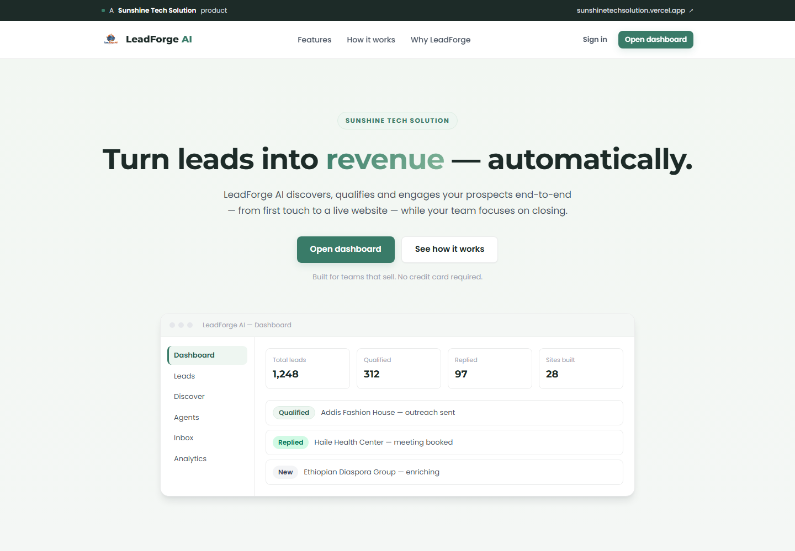
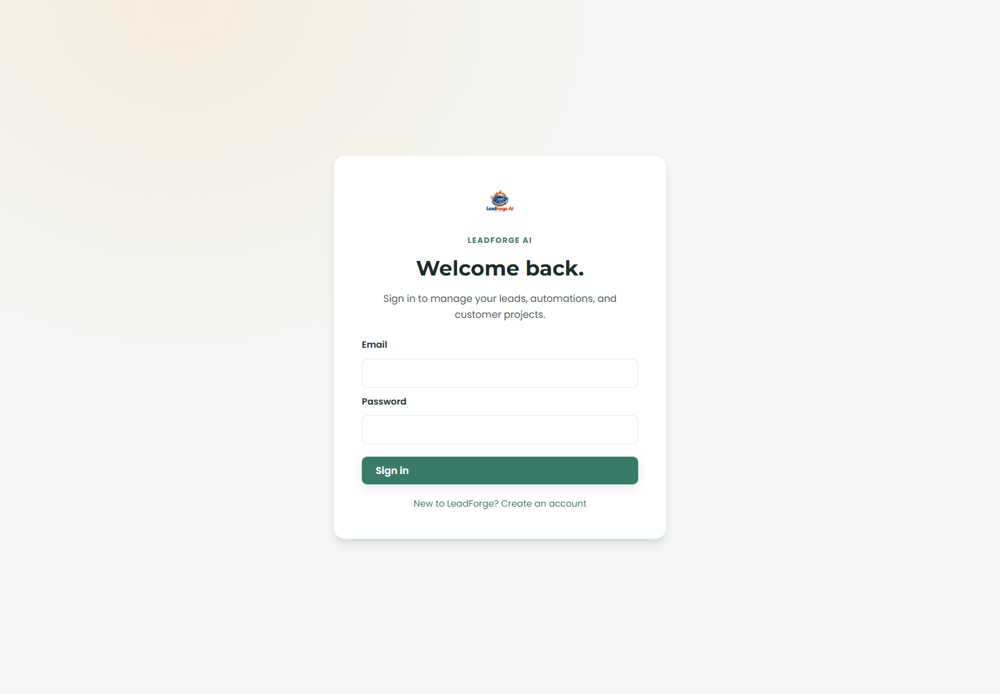

# LeadForge AI

**A workspace for moving from prospect discovery to customer-ready website delivery.**

[](https://nodejs.org/)
[](https://nextjs.org/)
[](https://supabase.com/)

LeadForge AI connects lead management, human-reviewed outreach, AI-assisted
workflows, and website delivery in one product. It is an official product of
Sunshine Tech Solution, with its own focused workflow and interface.

> **Development status:** LeadForge is under active development. Email sending,
> AI, lead discovery, and deployment need provider configuration. Inbox sync,
> team access, and billing are not active. Review
> [capabilities and limitations](#capabilities-and-limitations) before using it
> with real customers.

## On this page

- [Product tour](#product-tour)
- [Screenshots](#screenshots)
- [How the workflow works](#how-the-workflow-works)
- [Capabilities and limitations](#capabilities-and-limitations)
- [Architecture](#architecture)
- [Technology](#technology)
- [Run locally](#run-locally)
- [Configuration](#configuration)
- [Documentation](#documentation)
- [Development and tests](#development-and-tests)
- [Security](#security)

## Product tour

LeadForge is organized around a practical lead-to-delivery path:

1. Add prospects manually or search provider-sourced records with Apollo.
2. Draft outreach, then review and approve it before it is sent.
3. Keep conversation history with a lead and capture project requirements.
4. Generate website project files, review the source, and deploy to Vercel when
   configured.

AI actions run when a user starts a workflow step. They do not run background
campaigns or monitor an inbox.

## Screenshots

The images below are captured from the running frontend. The landing-page
dashboard preview contains fictional sample content; the sign-in image does
not show authenticated customer data.

<p align="center">
  
</p>
<p align="center"><em>LeadForge AI — public product page</em></p>

<p align="center">
  
</p>
<p align="center"><em>Secure sign-in to a private workspace</em></p>

## How the workflow works

```text
Find prospects → Review outreach → Manage conversations
              → Capture requirements → Generate site files → Deploy
```

Human approval is required before outreach is sent, and generated site files
can be reviewed before deployment.

## Capabilities and limitations

### Available

- Supabase email/password authentication and workspace-scoped API access.
- Lead, outreach draft, conversation, project, and analytics workflows.
- Optional Apollo prospect search; fictional AI samples are clearly labeled and
  cannot be saved as contactable leads.
- Workspace OpenRouter key settings, encrypted by the backend with AES-256-GCM.
- Website generation and Vercel deployment when the required credentials are
  configured.

### Not active or requiring care

- Inbound email and inbox synchronization are not implemented. Lead replies
  entered in the UI are development/testing simulations.
- Email delivery uses backend-wide Gmail OAuth2 or SMTP credentials, not
  per-workspace connections. Without a configured provider, outreach remains
  pending and is not reported as sent.
- Team invitations and shared workspace membership are not implemented; each
  account gets a private workspace.
- OAuth tokens, email-tracking events, and the recent activity feed are kept in
  process memory and are not durable.
- Generated project files are stored on the backend filesystem. They may need
  to be rebuilt after server cleanup or restart; durable object storage is not
  configured.
- Stripe is scaffolding only. Checkout, subscriptions, and payment processing
  are disabled.
- Existing records from before workspace isolation are not automatically
  assigned to new accounts.

## Architecture

```text
┌─────────────────────┐       ┌────────────────────────┐
│ Next.js frontend    │──────▶│ Express API            │
│ Supabase sign-in    │ REST  │ Supabase token checks  │
│ Workspace dashboard│       │ Workflow and AI routes │
└─────────────────────┘       └───────────┬────────────┘
                                          │ Prisma
                              ┌───────────▼────────────┐
                              │ PostgreSQL             │
                              └────────────────────────┘
```

The frontend is in [`leadforge-ai/frontend`](leadforge-ai/frontend/); the API,
Prisma schema, and migrations are in [`leadforge-ai/backend`](leadforge-ai/backend/).
Each authenticated account is mapped to a private workspace. AI credentials
are encrypted and are never returned to the browser.

## Technology

| Area | Stack |
|---|---|
| Frontend | Next.js 15, React 18, SWR |
| API | Node.js 20+, Express |
| Data | PostgreSQL, Prisma |
| Authentication | Supabase Auth |
| AI | OpenAI-compatible API, including OpenRouter |
| Tests | Node.js built-in test runner |

## Run locally

### Requirements

- Node.js 20 or later and npm
- PostgreSQL
- A Supabase project for sign-in

### 1. Configure Supabase

Create a Supabase project, enable email/password sign-in, and configure local
redirect URLs for `http://localhost:1101`. Follow
[Supabase setup and migration instructions](leadforge-ai/BYOK_AND_BILLING.md#accounts-and-workspaces).

### 2. Start the backend

In PowerShell, from the repository root:

```powershell
cd leadforge-ai\backend
Copy-Item .env.example .env
```

Fill in the database URL, Supabase URL and public key, and OAuth state secret
in `backend\.env`. Then install dependencies and prepare a fresh database:

```powershell
npm install
npm run prisma:migrate
npm run dev
```

The API starts at `http://localhost:4000`. If the database already contains
legacy LeadForge tables, do not apply the initial migration directly; use the
[existing-database migration guide](leadforge-ai/BYOK_AND_BILLING.md#accounts-and-workspaces).

### 3. Start the frontend

Open another PowerShell terminal from the repository root:

```powershell
cd leadforge-ai\frontend
Copy-Item .env.local.example .env.local
```

Set `NEXT_PUBLIC_SUPABASE_URL` and `NEXT_PUBLIC_SUPABASE_ANON_KEY` in
`frontend\.env.local`, then start the app:

```powershell
npm install
npm run dev
```

Open [http://localhost:1101](http://localhost:1101).

## Configuration

Environment templates:

- [Backend `.env.example`](leadforge-ai/backend/.env.example)
- [Frontend `.env.local.example`](leadforge-ai/frontend/.env.local.example)

Keep populated environment files private. Only Supabase's public anon or
publishable key belongs in frontend configuration; never put a secret or
service-role key in a `NEXT_PUBLIC_` variable. See the
[BYOK, accounts, and billing guide](leadforge-ai/BYOK_AND_BILLING.md) for
provider setup and deployment details.

## Documentation

| Guide | Description |
|---|---|
| [BYOK, accounts, and billing](leadforge-ai/BYOK_AND_BILLING.md) | Supabase, migrations, encrypted AI keys, email delivery, and deployment |
| [OpenRouter configuration](leadforge-ai/OPENROUTER_CONFIGURATION.md) | AI provider configuration |
| [OpenAPI specification](leadforge-ai/backend/openapi.yaml) | API contract |
| [Frontend](leadforge-ai/frontend/) | Next.js application source |
| [Backend](leadforge-ai/backend/) | Express API and Prisma source |

## Development and tests

Run the backend tests:

```powershell
cd leadforge-ai\backend
npm test
```

Build the frontend for production:

```powershell
cd leadforge-ai\frontend
npm run build
```

## Security

- Never commit API keys, database URLs, or populated environment files.
- Add workspace AI keys through the application settings; do not share them in
  chat, issues, or documentation.
- Keep `AI_KEY_ENCRYPTION_KEY` stable and backed up. Replacing it makes saved
  encrypted workspace keys unreadable.
- Revoke and replace any credential that may have been exposed.
